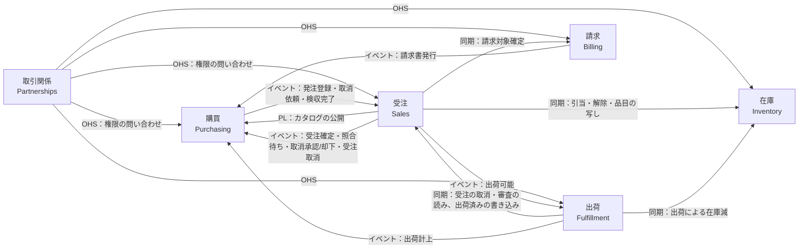

# コンテキストマップ

発注する会社と受注する会社が同じシステムを使い、一方の発注がもう一方の受注に連結する。本書は、この業務を境界づけられたコンテキストに分け、コンテキスト同士のつなぎ方を定める。設計判断の一般原則は `decisions.md` に従い、本書はそれを本デモの業務に当てはめる。

## 業務の流れ

1 件の取引に登場するテナントは 2 種類ある。

- **発注側テナント**：部品を買う会社（例：産業機械の組立メーカー）
- **受注側テナント**：部品を売る会社（例：青嵐精機工業）

1 つのテナントが、ある取引では発注側、別の取引では受注側になってもよい。

取引は次の順に進む。

```
発注側：  カタログを見る → 自社品番で発注する ───────────────→ 状況を見る → 入荷を検収する ──────────────→ 請求書を受け取る
                              │（発注の連結）           ↑（状況の還流）        │（検収の返送）              ↑（請求書の写し）
受注側：                      └→ 品番を照合して受注を作る → 引き当てる → 出荷指示 → 出荷実績を計上する  └→ 受注を検収済みにする → 月次で締めて請求書を発行する
```

- **伝票はそれぞれが自社で持つ**：発注側の「発注」と受注側の「受注」は別の伝票である。請求書も、受注側が発行した原本と、発注側が受け取った写しを別に持つ。1 つの伝票を 2 社で共有しない。所有者を必ず 1 つにする原則（`decisions.md` 2 章）を、伝票の形で守るためである。
- **イベントでつなぐ**：2 つの伝票は、発注登録・受注確定・出荷計上・検収完了などのイベントで連結する。相手の伝票を直接書き換えることはない。

発注側は自社の部品番号（自社品番）で発注する。受注側の品目コードへの読み替えは、受注側が受注を作るときに行う（「発注の連結と品番の照合」）。

発注側は発注を取り消せる。ただし受注側の承認が要る（「取消の流れ」）。

発注側が入荷を検収すると、検収の結果が受注側へ返る。受注側は検収した数量に受注単価を掛けて、取引先ごとに月次で締めて請求する（「検収と請求の流れ」）。

## コンテキスト

6 つのコンテキストに分ける。中核は、テナントをまたいで業務を連結する「購買」と「受注」である。

| コンテキスト | パッケージ | 所有するもの | 誰の業務か |
|---|---|---|---|
| 取引関係 | `packs/partnerships`（`Partnerships::`） | テナント、ユーザー、取引関係、権限付与 | 両者（基盤） |
| 購買 | `packs/purchasing`（`Purchasing::`） | 発注、発注明細、取消依頼、入荷検収、受領請求書 | 発注側 |
| 受注 | `packs/sales`（`Sales::`） | 品目カタログ、販売単価の履歴、得意先品番の対応表、受注、受注明細、取消の審査 | 受注側 |
| 在庫 | `packs/inventory`（`Inventory::`） | 在庫、引当、在庫移動履歴 | 受注側 |
| 出荷 | `packs/fulfillment`（`Fulfillment::`） | 出荷指示、出荷実績 | 受注側 |
| 請求 | `packs/billing`（`Billing::`） | 請求条件（取引先ごとの締め日）、請求対象明細、請求書、請求明細 | 受注側 |

コンテキストに属さないパッケージは 5 つである。ルートパッケージは、`app/` と `lib/` で役割が違うので 2 行に分ける。

| パッケージ | 役割 |
|---|---|
| `packs/platform` | Rails の基底クラス（`ApplicationRecord`・`ApplicationJob`）とテナントの仕組み（`Current`・`Tenancy`）。どのパッケージにも依存せず、公開 API を限定しない。基底クラスをルートパッケージに置くと、パッケージからルートへの依存が循環になるため、ここに置く |
| `packs/contracts`（`Contracts::`） | コンテキスト間のイベント（公表された言語）と、その配送。`platform` だけに依存する。配送表（`Contracts::Subscriptions`）は、全パッケージの受け手を文字列で名指しする意図した集中登録で、受け手のパッケージには、実行時に `EventJob` が受け手の名前を解決するときだけ依存する。受け手は `EventJob` からだけ呼ばれる（`spec/packwerk/entry_callers_spec.rb`） |
| `packs/notifications`（`Notifications::`） | 外部へのメールの送信と、配信結果の受信。通知の種類と本文の項目の名前（請求書の受領・新しい受注など）は持つが、業務の判断（いつ・誰に送るかの条件の外の、業務の状態の読み書き）は持たない。どのコンテキストからも「どの種類の通知を・本文のどの値で」だけを受け取る。送信先（内部の `Provider`）は外へ出さない。宛先は通知の種類ごとに決め、メールアドレスを `partnerships` の公開 API で引く。非同期処理の型は `../adr/007-非同期処理の型をジョブを失ったときの影響で選ぶ.md` |
| `packs/imports`（`Imports::`） | CSV の一括取り込み。置き場を持ち、反映は受注と在庫の公開 API を呼んで行う。業務の不変条件は各コンテキストの公開 API に残す |
| ルートパッケージの `app/` | GraphQL の API（`app/graphql/`）と、セッションとファイルの受け口のコントローラ（`app/controllers/`）。各コンテキストの公開 API だけを使う |
| ルートパッケージの `lib/` | シードと E2E の世界（`DemoWorld`）・運用の rake タスク（`lib/tasks/`）・公開の配置の作り直しの入口（`DemoReset`）。各コンテキストの公開 API だけを使う。`admin` に限る操作の規則は、同じルートパッケージの mutation の宣言から読む（`DemoWorld::Operations`） |

factory-ops-demo の画面は次のように移る。

| factory-ops-demo の画面 | 移る先 |
|---|---|
| 品目マスタ | 受注（品目カタログ） |
| 得意先マスタ | 取引関係（得意先は「取引関係にあるテナント」になる） |
| 受注一覧・受注詳細 | 受注 |
| 在庫一覧・入出庫調整 | 在庫 |
| 出荷指示一覧 | 出荷 |
| ダッシュボード | ルートパッケージの読み取り専用クエリ。複数コンテキストの公開 API を束ねる |
| （新規）カタログ閲覧・発注・取消依頼・入荷検収・受領請求書 | 購買 |
| （新規）得意先品番の対応表・取消の審査 | 受注 |
| （新規）請求条件・締め処理・請求書一覧 | 請求 |

請求を受注から分けるのは、締めの単位が受注ではなく「取引先 × 締め期間」で、受注をまたいで明細を集めるからである。

カタログを受注コンテキストに含めるのは、品目と販売単価が「受注側が取引先へ公開する売り物」で、受注明細と同じ言葉で語られるからである。カタログの公開範囲（どの取引先にどの品目を見せるか）が独立した業務に育ったら、別のコンテキストへ切り出す。

## コンテキスト間の関係



| 上流 → 下流 | パターン | つなぎ方 | 結合 |
|---|---|---|---|
| 取引関係 → 全コンテキスト | 公開ホストサービス（OHS）。下流は順応者 | 「テナント X は Y に対して操作 Z をしてよいか」に答える公開 API。各コンテキストの policy scope がこれを使う | 同期・読み取りのみ |
| 受注 → 購買 | 公表された言語（PL） | カタログを取引先向けの読み取り専用の形（`Sales::PublishedCatalog`）で公開する | 同期・読み取りのみ |
| 購買 → 受注 | 顧客／供給者＋腐敗防止層 | 購買が「発注登録」「取消依頼」「検収完了」を出す。受注側の購買のイベントの受け手（「発注登録」は `Sales::PurchaseOrderTranslator`、「取消依頼」「検収完了」は `Sales::PurchasingEventReceiver`）が受け取る。受け手は、発注側の自社品番を対応表で受注側の品目に読み替える翻訳（腐敗防止層）の後に、受注側の操作（受注の作成・取消の審査の作成と自動の却下・検収の反映）を呼ぶ | 非同期 |
| 受注 → 購買 | 顧客／供給者 | 受注が「受注確定」「品番照合待ち」「取消承認」「取消却下」「受注取消」を出す。購買は発注の状況欄を更新する | 非同期 |
| 受注 → 在庫 | 顧客／供給者 | 受注が在庫の公開 API（`Inventory::Allocation`）を呼ぶ。品目を書く受注の公開 API は、在庫の公開 API（`Inventory::ItemLabels`）で品目のコードと名前を在庫の写しへ書く。在庫の一覧は、それで並べ、検索する（`../adr/011-在庫の一覧のために品目のコードと名前を同期で写す.md`）。受注の品目の一覧は、在庫の公開 API（`Inventory::Stocks.safety_stocks_sql`）が返す安全在庫の副問い合わせを結んで並べる | 同期・同一トランザクション |
| 受注 → 出荷 | 顧客／供給者 | 全量引当済みの受注について「出荷可能」を出す。「出荷可能」は、出荷依頼の一覧を受注番号で並べるために受注番号を運ぶ。同じテナントの中で受注から出荷へ渡るのは、このイベントだけである（`../adr/012-同じテナントの中の連結を同期にし出荷可能だけをイベントで残す.md`） | 非同期 |
| 出荷 → 在庫 | 顧客／供給者 | 出荷実績の計上時に、在庫の公開 API で現在庫と引当を減らす | 同期・同一トランザクション |
| 出荷 → 受注 | 顧客／供給者 | 出荷が受注の公開 API（`Sales::OrderShipping`）を呼ぶ。出荷依頼の状況は、受注の取消済と未決の取消の審査を返す副問い合わせを結んで導出する（取消済・出荷停止中）。出荷指示の作成と計上は、受注の行をロックして取消済と審査中を読み、計上は同じトランザクションで受注を出荷済みにする | 同期・同一トランザクション |
| 出荷 → 購買 | 公表された言語 | 「出荷計上」を出す。購買は入荷予定にする。このイベントは連結元の発注明細 ID を運ぶ。出荷は、その ID を「出荷可能」で受注から受け取る | 非同期 |
| 受注 → 請求 | 顧客／供給者 | 検収済みの受注明細について、請求の公開 API（`Billing::BillableItems.confirm`）で請求対象を確定する。請求は未請求の明細として蓄える | 同期・同一トランザクション |
| 請求 → 購買 | 公表された言語 | 請求書の確定時に「請求書発行」を出す。購買は写しを受領請求書として保存する | 非同期 |

同期と非同期は、整合性の要求で使い分ける。

- **同期**：同じテナントの中の連結は、同じトランザクションの中で相手の公開 API を呼ぶ。在庫の引当と出荷による在庫減は、在庫数の不変条件（有効在庫 ≥ 0）を行ロックで守る必要がある。一覧のために別のコンテキストへ写す値（在庫の品目の写し）は、イベントで写すと、写しが届くまで一覧が古い値で並び、届く順の入れ替わりを比べる版の列が要る。受注と出荷・請求（取消・審査による出荷停止、出荷済み、請求対象確定）は、イベントでつなぐと、届く順の入れ替わりに備える仕組み（先回りの行・先着の失敗・勧告ロック）が要る。
- **非同期**：テナントをまたぐ連結は、相手側の処理が遅れても自社の操作を完了させるため、イベントでつなぐ。同じテナントの中の例外は受注から出荷への「出荷可能」だけで、受注が出荷を呼ぶと、出荷が受注を読む向きと依存が循環するからである。遅れて届いても、出荷依頼の状況は受注から導出するので害が無い（`../adr/012-同じテナントの中の連結を同期にし出荷可能だけをイベントで残す.md`）。

## 発注の連結と品番の照合

受注側が、発注側の自社品番を自社の品目へ読み替えて、受注を作る。対応表とその照合は受注側の持ち物で、発注側からは見えない。

1. 発注側が、自社品番・数量・希望納期で発注を登録する。購買は「発注登録」イベントを出し、発注の状況は「送信済み」になる。
2. 受注側の購買のイベントの受け手（`Sales::PurchaseOrderTranslator`）が、受注側テナントの名義で受注を作る。明細ごとに、得意先品番の対応表（取引先 × 得意先品番 → 自社品目）で品目を引き当てて読み替え（翻訳。腐敗防止層の役）、連結元の発注明細 ID を受注明細に持たせる。単価は、受注側のカタログから受注日に有効な販売単価を写す（`../adr/006-販売単価を有効期間と記録期間の2軸で持つ.md`）。
3. 全明細が照合できたら、受注を「受注済」で確定し、「受注確定」を出す。このイベントは確定した品目名と単価を運び、購買は発注明細に写す。受注側の `admin` には、新しい受注をメールで知らせる。知らせは失ってもよい。確定した受注は受注一覧に出るので、業務は進む（`../adr/007-非同期処理の型をジョブを失ったときの影響で選ぶ.md` の B-1）。
4. 照合できない明細が 1 つでもあれば、受注を「品番照合待ち」で止め、「品番照合待ち」を出す。発注側の状況は「受注側で確認中」になる。
5. 受注側の担当者が対応表に品番を登録すると、受注の公開 API（`Sales::PartMappings.register`）が、受け手と同じ読み替えでその取引先の照合待ちの受注を照合し直し、全明細が照合できた受注ごとに手順 3 へ進む。照合済みの明細は、後から対応を差し替えても変えない。

照合できない明細を含む受注と、受注確定の前の発注（単価の写しが無い明細を持つ）は、合計金額を持たない。画面は合計の代わりに「照合待ち」「確定待ち」を出し、決まった明細だけの一部の合計を出さない。一部の合計を出すと、画面ごとに合計が食い違って見えるからである。照合待ち・確定待ちのまま取り消した伝票は、もう何も待たないので、合計の代わりに「取消」を出す。詳細の明細の行も、待ちの文言（受注の「品番照合待ち」、発注の「受注側の確定待ち」）の代わりに、何が無いままで取り消したかを出す（受注の「品番未照合（取消）」、発注の「未確定（取消）」）。単価の決まった伝票は、取り消しても合計を出す。合計で並べるときは、合計を持たない伝票を末尾にまとめる。

連結の冪等性は、受注に「連結元の発注 ID」をユニーク制約付きで持たせて担保する。同じイベントが 2 回届いても、受注は 1 件しかできない。

## 取消の流れ

発注側の取消は、受注側の承認を経て成立する。

1. 発注側が取消依頼を登録する。購買は発注の状況を「取消依頼中」にし、「取消依頼」を出す。発注そのものは、承認されるまで有効のままである。取消の理由は発注側の記録で、「取消依頼」に載せないので、受注側の担当者は理由を見ずに審査する。理由は自由記述で、相手テナントへ運ぶイベントに自由記述を入れないからである。
2. 受注側の購買のイベントの受け手（`Sales::PurchasingEventReceiver`）が、受注に「取消の審査」を作る。審査中は、出荷が未決の審査を読んで出荷依頼を出荷停止中と導出し、新しい出荷指示の作成と出荷実績の計上を止める。引当はそのまま残す。
3. 受注側の担当者が、承認か却下を選ぶ。
   - **承認**：受注を取り消す。引当の解除と取消済みにすることを、同じトランザクションで行う。そのうえで、購買へ「取消承認」を出す。購買は発注を「取消済み」にする。出荷は受注の取消を読んで出荷依頼を取消済と導出し、出荷指示を読む画面と並べ替えから除く。引当がすでに出荷で消費されていたら承認できず、担当者は却下する。
   - **却下**：審査を閉じる。購買へ「取消却下」を出す。購買の発注は、取消依頼の前の状況に戻る。出荷は、決着した審査を出荷停止と読まなくなる。
4. 取消依頼が届いた時点で受注がすでに出荷済みか取消済なら、受け手は審査を作らずに自動で却下する。

発注側の画面は、取消依頼の操作を、出荷の前の発注（送信済み・受注側で確認中・受注済）にだけ見せる。出荷済みの受注への依頼は手順 4 で必ず却下されるので、却下だけが返る操作を見せない。購買の公開 API は、出荷済みかを見ずに依頼を受け付ける（下の表）。

操作と状態の組みごとの結果は次のとおりである。失敗はどれも、書き込みとイベントを残さない。

| 操作 | 状態 | 結果 |
|---|---|---|
| 取消依頼 | 回答待ちの取消依頼がある | `CONFLICT` |
| 取消依頼 | 発注が「取消済み」か「受注側により取消」 | `CONFLICT` |
| 取消依頼 | それ以外（出荷済みかどうかは購買では見ない） | 依頼を登録し、「取消依頼」を出す |
| 取消依頼の受け手 | 受注が出荷済みか取消済 | 審査を作らずに「取消却下」を出す（自動の却下） |
| 取消依頼の受け手 | 受注がまだ無い（「発注登録」より先に届いた） | 例外で失敗し、再配送に任せる |
| 承認・却下 | 審査が決着済み | `CONFLICT` |
| 承認 | 引当が消費済み（出荷の計上が先に成立した） | `CONFLICT`。担当者は却下する |

審査中は、出荷停止で出荷指示の作成と出荷の計上が `CONFLICT` になる。出荷はイベントを待たずに受注の審査と取消を読むので、審査の作成と決着、受注の取消の直後から、出荷依頼の状況と操作に効く。

受注側が自社の都合で受注を取り消す場合は、審査を経ずに、承認と同じく、引当の解除と取消済みにすることを同じトランザクションで行う。そのうえで、購買へ「受注取消」を出す。購買は発注を「受注側により取消」にし、出荷は承認のときと同じく受注の取消から出荷依頼を取消済と導出する。

受注側の取消の結果は次のとおりである。失敗はどれも、書き込みとイベントを残さない。

| 状態 | 結果 |
|---|---|
| 受注が出荷済みか取消済 | `CONFLICT` |
| 未決の取消の審査がある | `CONFLICT`。担当者は審査を承認して取り消す |
| 引当が消費済み（出荷の計上が先に成立した） | `CONFLICT` |
| それ以外（品番照合待ち・引当前の受注を含む） | 取り消し、「受注取消」を出す |

審査中に受注側の取消を許さないのは、後から届く審査の決着で、発注に「取消済み」と「受注側により取消」の 2 つの取消の時刻が並びうるからである。受注側の取消は受注の行ロックを取ってから未決の審査を読み、取消依頼の受け手も受注の行ロックを取ってから審査を作る。そのため、同時に進んでも、取消が先なら受け手は取消済の受注として自動で却下し、受け手が先なら取消は `CONFLICT` になる。

状況が 2 社に分かれるため、審査中の出荷停止が無いと、次の競合が起きる。発注側が取消を依頼した後、受注側の別の担当者が出荷を計上してしまい、承認できない受注が残る。出荷停止は、この競合を業務の手順として防ぐ。同時の操作は、取消・審査の作成と決着・出荷指示の作成・計上がどれも最初に取る受注の行ロックで直列になる（`data-model.md`「取消と出荷の競合を止める場所」）。

## 検収と請求の流れ

発注側の検収が受注側の請求の根拠になる。請求金額は、検収した数量に受注明細の単価を掛けて決まる。

1. 発注側が、届いた出荷 1 件ごとに検収を登録する。検収数量は出荷数量以下とする。購買は「検収完了」を出す。このイベントは、出荷実績 ID、発注明細 ID ごとの検収数量、検収日を運ぶ。
2. 受注側の購買のイベントの受け手（`Sales::PurchasingEventReceiver`）が、発注明細 ID から連結先の受注明細を引き、検収数量を記録する。受注のすべての出荷実績が検収されたら、受注を「検収済」にする。
3. 受け手は、検収の記録と同じトランザクションで、検収数量が正の受注明細ごとに請求の公開 API（`Billing::BillableItems.confirm`）を呼び、請求対象を確定する。検収数量が 0 の明細は請求する額が無いので呼ばない。渡すのは、発注側テナント、出荷実績 ID、受注明細 ID・発注明細 ID、品目名・受注単価・税率、検収数量、検収日である。
4. 請求が、これを未請求の請求対象明細として蓄える。
5. 受注側の担当者が、取引先と締め日を指定して締めを実行する。請求は、検収日が締め日以前の未請求明細をすべて集めて下書きの請求書を作る。前の締めの後に届いた、前の期間の検収も含める。担当者は下書きを破棄して明細を未請求に戻せる。担当者が内容を確かめて確定すると、請求番号が振られ、明細は請求済みになり、請求は「請求書発行」を出す。締めの入力と結果、請求書の期間の決め方は `data-model.md`「請求（`billing`）」にある。
6. 購買が、請求書の値の写しを、発注側の名義で受領請求書として保存する。発注側はこの写しを閲覧する。購買は同じトランザクションで、自社の `admin` への「請求書が届きました」のメールを登録する。届かないと支払いの手配が遅れるので、失わない型（確実な外部送信）で送る。

発注側の担当者は、検収を次の規則で登録する。検収は入荷 1 件に 1 回で、検収日は検収を登録した日（自社の日付）である。業務の日付のうち、操作の日で決まるもの（受注日・発注日・検収日・請求書の発行日・単価の有効日、単価の改定日の下限、取り込みで改定日を省いたときの改定日）は、どれも日本時間の今日で決める。使うのは日本の会社だからである。出荷日・希望納期・出荷指示の予定日・締め日は、利用者が入力で渡す。

- 同じ入荷への 2 回目の検収は、入力を確かめる前に `CONFLICT` にし、「検収完了」を出さない
- 入荷の全明細を 1 回で出す。明細の省略・同じ明細の重複・別の入荷の明細は `INVALID_INPUT` にする。省略を 0 とみなすと、担当者が見落とした明細が全量の不合格になり、請求額が黙って変わるからである
- 検収数量は 0 以上・出荷数量以下の整数にし、外れれば `INVALID_INPUT` にする。0 は全量の不合格を表す。返品・再出荷は範囲外なので、不合格は数量で表すだけにする

失敗はどれも、検収も「検収完了」も残さない。

分納しないので、出荷実績は受注ごとに 1 件である。そのため手順 2 では、最初に届いた「検収完了」で受注が「検収済」になる。

請求書の組み立てには、次の規則がある。

- **締め期間**：取引先ごとの請求条件（締め日）で決まる。請求条件は請求が持ち、取引関係は持たない。
- **消費税**：請求書ごと・税率ごとに 1 回だけ端数を処理する。明細ごとに丸めて足し上げると、適格請求書の要件を満たさない。
- **確定後の請求書**：変更しない。確定した請求書の訂正は範囲外である。

冪等性は、受け手ごとのユニーク制約で担保する。受注側の検収記録と請求対象明細は「出荷実績 ID × 受注明細 ID」で、受領請求書は「請求書 ID」で一意にする。

検収の数量と出荷の数量の差異の処理（返品・再出荷）と入金消込は範囲外とする。

## 取引関係の失効

受注側が取引関係を失効させると、相手テナントのデータを読む経路と新しい取引が閉じる。連結済みの取引は完了まで進む。

**閉じるもの**
- 相手テナントのデータを読む 3 つの経路（「テナントと所有」）
- 新しい発注。購買は発注を登録するときに取引関係の公開 API へ権限を問い合わせ、失効していれば拒否する

**閉じないもの**
- 「発注登録」を出し終えた発注と、それに連結する受注・出荷・検収・請求。発注側は、連結済みの発注について取消依頼と検収を出せる

失効と同時に登録される発注は、どちらか一方に必ず入る。購買は権限を問い合わせる前に、取引関係の公開 API は失効と `place_orders` の撤回の前に、受注側と発注側の組のロックを取り、トランザクションの終わりまで持つ。そのため発注は、失効より先にコミットして閉じないものに入るか、失効の後に問い合わせて拒否されるかのどちらかになる。問い合わせはロックを取らずに読むので、取引関係の行のロックだけでは、問い合わせの後に失効がコミットし、その後に発注と「発注登録」がコミットしうる。

イベントの受け手は、取引関係の状態を見ずに処理する。イベントは、発行元が発行の時点で権限を確かめた操作の結果であり、受け手は自社の名義で自社のデータを更新するだけだからである。失効後、発注側は自社の発注の状況と受領請求書で取引を追う。どちらも発注側が所有するデータなので、失効の影響を受けない。

## 疎結合を守る規則

6 つの境界が崩れていないことを、packwerk と CI で機械的に保証する。packwerk を初日から CI で強制する判断は `../adr/002-packwerkを初日からCIで強制する.md` に記録した。

1. **コンテキストをまたいで AR の関連を張らない。** 他コンテキストのレコードは ID で参照し、`belongs_to` や `has_many` でたどらない。外部キー制約もコンテキストの中に限る。
2. **他コンテキストへの入口は、公開 API とイベントだけにする。** 公開 API は各パッケージの `app/public/` に置く（例：`packs/inventory/app/public/inventory/allocation.rb`）。依存の向きと公開 API 以外の参照は、packwerk の依存チェックとプライバシーチェックで CI が落とす。
3. **イベントは `packs/contracts` に定義する。** イベントは ID と、受け手が必要とする値の写しだけを運ぶ。発行元のモデルそのものは運ばない。
4. **イベントは、発行元の業務データと同じトランザクションでジョブとして登録する。** Solid Queue を業務 DB と同じ接続に置き、イベントのジョブはコミットの後に回さず、トランザクションの中で投入する。操作が戻ればイベントも消え、確定すればイベントも必ず残るので、outbox は要らない。受け手は冪等に処理する（`../adr/005-イベントのジョブをトランザクション内で登録する.md`）。
5. **GraphQL 層はルートパッケージに置き、各コンテキストの公開 API だけを使う。** コンテキスト同士の依存を、GraphQL 層が代わりに作らない。

許可する依存の向きは次のとおり。表は、いまあるパッケージの `package.yml` の `dependencies` と一致させ、まだ作っていないパッケージを載せない。パッケージを作るマイルストーンが、そのパッケージの行と、それに依存するパッケージの依存先を足す。

| パッケージ | 依存してよい先 |
|---|---|
| `purchasing` | `platform`、`partnerships`、`contracts`、`sales`（`PublishedCatalog` だけ）、`notifications` |
| `sales` | `platform`、`partnerships`、`contracts`、`inventory`、`notifications`、`billing` |
| `fulfillment` | `platform`、`partnerships`、`contracts`、`inventory`、`sales` |
| `billing` | `platform`、`partnerships`、`contracts` |
| `inventory` | `platform`、`partnerships` |
| `notifications` | `platform`、`partnerships` |
| `imports` | `platform`、`partnerships`、`sales`、`inventory` |
| `partnerships` | `platform` だけ |
| `contracts` | `platform` だけ（配送表は受け手を文字列で名指しし、実行時に `EventJob` が名前を解決するときだけ受け手のパッケージに依存する） |
| `platform` | なし |
| ルートパッケージ | すべて |

購買と受注は互いに直接依存しない。発注と受注の連結はイベントだけで行う。例外は、購買から受注の `PublishedCatalog` を読むことだけである。packwerk は公開 API の中のクラスを区別しないので、この例外の範囲は `spec/packwerk/purchasing_uses_only_published_catalog_spec.rb` が守る。

出荷は受注に、受注は請求に依存する（同じテナントの中の同期の呼び出し）。受注は出荷に、請求は受注にも出荷にも依存しないので、依存は循環しない。受注から出荷へは「出荷可能」のイベントだけで渡し、受注が出荷を呼ばない（`../adr/012-同じテナントの中の連結を同期にし出荷可能だけをイベントで残す.md`）。循環は `bin/packwerk validate` が落とす。

## テナントと所有

コンテキストごとに、レコードの所有テナントと、相手テナントから見えるものを示す。

| コンテキスト | レコード | 所有テナント | 相手テナントから見えるもの |
|---|---|---|---|
| 取引関係 | 取引関係、権限付与 | 関係を結んだ受注側（権限を与える側） | 発注側は、自社が当事者である関係を閲覧できる |
| 受注 | 品目カタログ | 受注側 | 権限付与のある発注側は、公開対象の品目と今日の単価を閲覧できる |
| 受注 | 販売単価の履歴（改定の予定・訂正） | 受注側 | 見えない |
| 受注 | 得意先品番の対応表、受注、取消の審査 | 受注側 | 見えない。発注側は、購買に還流した状況だけを見る |
| 購買 | 発注、取消依頼、入荷検収、受領請求書 | 発注側 | 見えない。受注側は、購買のイベントの受け手が作った自社の受注と、検収から作った請求書を見る |
| 在庫 | 在庫、引当、在庫移動履歴、品目の写し | 受注側 | 見えない |
| 出荷 | 出荷指示、出荷実績 | 受注側 | 権限付与のある発注側は、自社の発注に連結した出荷の状況（出荷日・数量）を閲覧できる |
| 請求 | 請求条件、請求対象明細、請求書 | 受注側 | 見えない。発注側は、購買に届いた写し（受領請求書）を見る |
| 通知・取り込み・監査ログ | 送信記録、取り込み、監査ログ | 書き込んだテナント | 見えない |

**相手テナントのデータを読む経路は 3 つに限る。**
1. カタログ
2. 取引関係
3. 自社の発注に連結した出荷の状況

**相手テナントの名義でデータを書く経路は無い。** 受注は、受注側の購買のイベントの受け手が受注側の名義で作る。受領請求書は、購買が発注側の名義で作る。

この境界を確かめるテストと仕組みは、`../showcase.md`「1. テナントの境界：読む 3 経路、書けないこと、失効」と「6. GraphQL の安全な形」にまとめた。

## 自社の中の役割

テナントの中のユーザーは、`admin` か `member` のどちらかの役割を持つ（`data-model.md` の `users`）。日常の業務は役割を問わない。取引関係を変える操作と、取引を取り消すか、金額を決めるか確定させる操作は、`admin` に限る。どれも相手テナントとの約束を変え、元に戻す操作が無いからである。単価は、発注側のカタログに見え、受注と請求書の金額になるので、金額を決める操作に入れる。既存の品目の単価を変える入口は、改定の予約と訂正の 2 つだけにし、品目の登録からは変えられない。

| 操作 | 許す役割 |
|---|---|
| 取引関係を結ぶ・失効させる、権限付与を与える・撤回する | `admin` |
| 発注側の取消依頼 | `admin` |
| 取消の審査の承認・却下、受注側の取消 | `admin` |
| 検収 | `admin` |
| 請求条件の設定、締め、下書きの破棄、請求書の確定 | `admin` |
| 単価の改定の予約と訂正、単価の列を含む CSV（品目）の取り込み | `admin` |
| 監査ログと自社の取引用コードを読む | `admin` |
| それ以外（発注の登録、品目の登録（新しい品目の最初の単価を含む）と公開、品番の対応表、引当、出荷指示と出荷の計上、在庫の調整、在庫の CSV の取り込み、伝票を読む） | 役割を問わない |

役割を判定する場所は、`graphql-schema.md`「役割による制限」にある。
